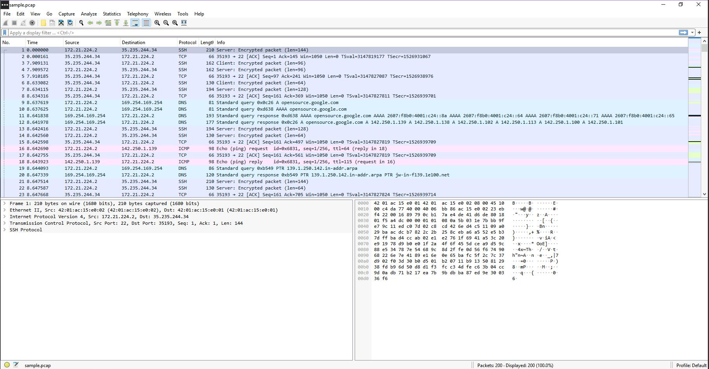
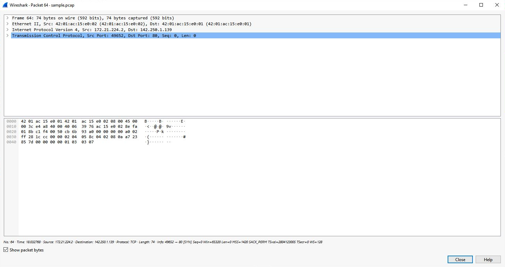
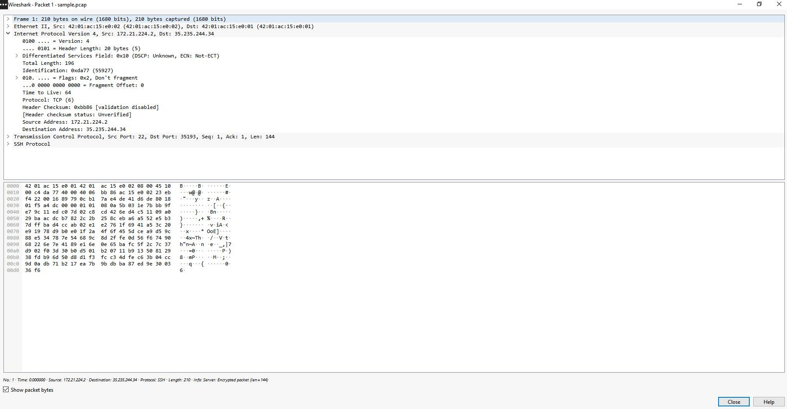
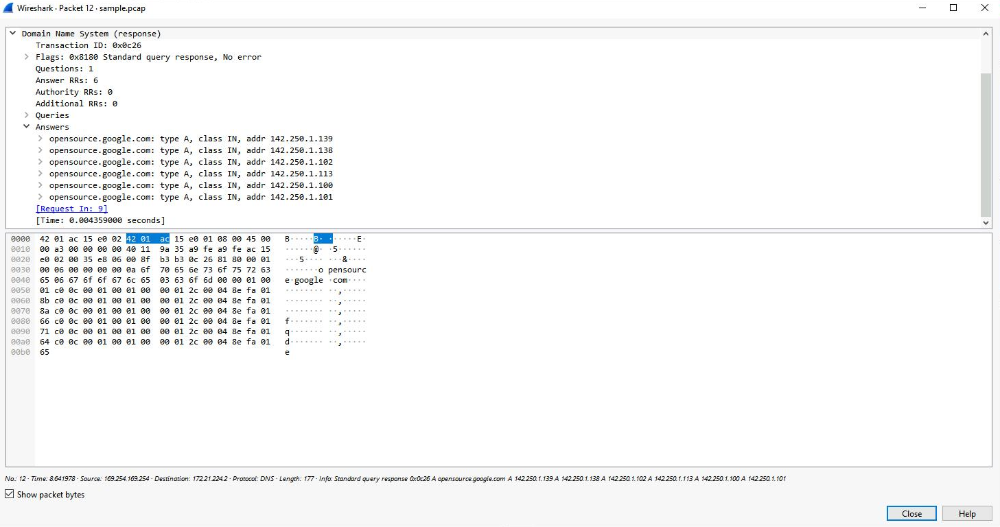
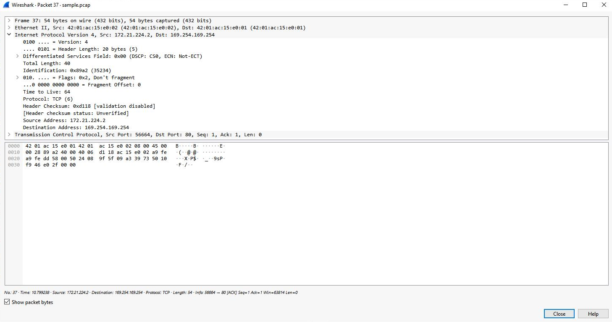
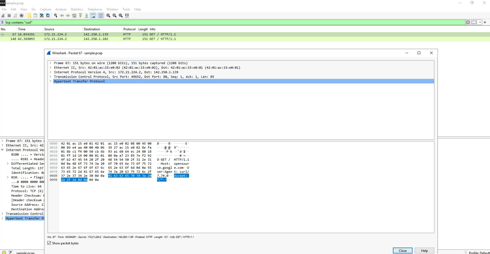

# Wireshark Packet Analysis

## Summary
A guided course lab where I used Wireshark to open a sample packet capture of a user browsing to a website, then applied display filters to isolate traffic by IP address, MAC address, protocol, and port. I inspected individual packets layer by layer (Frame, Ethernet II, IPv4, TCP/UDP, DNS, HTTP) and searched payload data for specific text.

> Part of my [Incident Response Journal](https://github.com/john-danko-cyber/incident-response-journal) (Entry 2), which collects all my Detection and Response course labs.

## My Role
I worked in the course's Windows lab VM with Wireshark and the provided `sample.pcap` file. I applied each filter, examined the packet details, answered the lab's questions, and took the screenshots in this repo. The capture file and lab environment were provided by the course; no live network was monitored.

## Project Overview

This project documents a Wireshark packet inspection lab from the Google Cybersecurity Certificate (Sound the Alarm: Detection and Response). The goal was to identify the source and destination IP addresses in a web browsing session, examine the protocols used to connect to the site, and analyze packets to see what information was sent and received.

---

## Scenario

As a security analyst investigating traffic to a website, I analyzed a packet capture containing a user's system (172.21.224.2) connecting to `opensource.google.com`. The capture holds 200 packets, including SSH, DNS, ICMP, TCP, and HTTP traffic.

---

## Tools Used

- **Wireshark** (network protocol analyzer with a GUI)
- Wireshark display filters

---

## Filters Applied

| Filter | Purpose |
|---|---|
| `ip.addr == 142.250.1.139` | Traffic to or from one IP address |
| `ip.src == 142.250.1.139` | Traffic sent from that IP only |
| `ip.dst == 142.250.1.139` | Traffic sent to that IP only |
| `eth.addr == 42:01:ac:15:e0:02` | Traffic to or from one MAC address |
| `udp.port == 53` | DNS queries and responses |
| `tcp.port == 80` | HTTP web traffic |
| `tcp contains "curl"` | Packets whose TCP payload contains the text "curl" |

---

## Key Findings

- **ICMP:** The first `Echo (ping) request` (packet 16) was ICMP, sent from 172.21.224.2 to 142.250.1.139.
- **TCP connection:** Filtering on 142.250.1.139, the first TCP packet (packet 64) was a SYN from source port 49652 to **destination port 80**, the start of an HTTP connection.
- **MAC filter:** The first packet for MAC 42:01:ac:15:e0:02 (packet 1, SSH) carried **TCP** inside IPv4 (Protocol: TCP (6)).
- **DNS:** The DNS response for `opensource.google.com` (packet 12, from 169.254.169.254 on UDP 53) returned six A records, with **142.250.1.139** listed first (also .138, .102, .113, .100, .101).
- **Port 80 packet details:** The first `tcp.port == 80` packet (packet 37, to 169.254.169.254) had a **TTL of 64**, a **frame length of 54 bytes**, an **IPv4 header length of 20 bytes**, and a destination address of **169.254.169.254**.
- **Payload search:** `tcp contains "curl"` returned two HTTP `GET /` requests (packets 67 and 148, to 142.250.1.139 and 142.250.1.102). The payload showed `Host: opensource.google.com` and `User-Agent: curl/7.74.0`, so the requests came from the curl command-line tool rather than a web browser.

---

## Screenshots

### 1. Packet list and first ICMP echo request

### 2. TCP packet to destination port 80 (`ip.addr == 142.250.1.139`)

### 3. IPv4 protocol field for MAC 42:01:ac:15:e0:02

### 4. DNS answers for opensource.google.com (`udp.port == 53`)

### 5. IPv4 details of a port 80 packet (`tcp.port == 80`)

### 6. Payload search (`tcp contains "curl"`)

---

## Skills Demonstrated

- Opening and navigating a packet capture in Wireshark
- Writing display filters by IP address, MAC address, protocol, port, and payload text
- Reading packet layers: Frame, Ethernet II, IPv4, TCP, UDP, DNS, and HTTP
- Interpreting TCP ports and flags, IPv4 TTL and header length, and DNS queries and answers
- Identifying the tool behind web requests from the HTTP User-Agent header

---

## What I Learned

- Display filters turn a large capture into a small, relevant set of packets quickly.
- Each packet is layered: Ethernet carries IP, IP carries TCP or UDP, and those carry application protocols like HTTP and DNS.
- DNS (UDP port 53) shows which domain names a host looked up and the IP addresses it got back.
- Searching payload text (for example, `tcp contains`) can reveal how traffic was generated, such as curl instead of a browser.
- Coloring rules give fast visual cues for protocol types in the packet list.

---

## Disclaimer

Guided course lab from the Google Cybersecurity Professional Certificate (Coursera). The packet capture was provided by the course in a lab VM; no live network traffic was captured or monitored. The write-up is my own.

## Certificate
Google Cybersecurity Certificate — Sound the Alarm: Detection and Response
